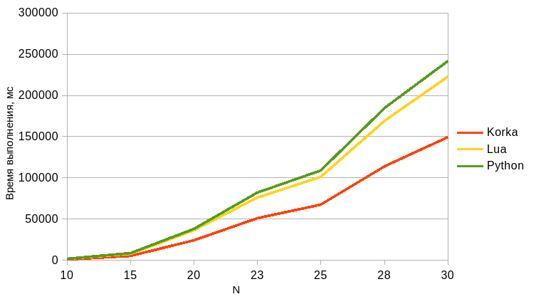

# Korka

A Virtual Machine where lexing and compilation happen entirely at **compile-time**.

---

### What is this

Korka is a project where I'm trying to create a tool that allows to embed logic
without runtime overhead of parsing or loading external files. You write C-like code
right inside C++, and the compiler transforms it into internal bytecode before your
program even starts.

### Status

|    Component     | Stage | Execution context |
|:----------------:|:-----:|:-----------------:|
|      Lexer       | Done  |     constexpr     |
| Bytecode builder | Done  |     constexpr     |
|      Parser      | Done  |     constexpr     |
|     Compiler     | Done  |     constexpr     |
|    VM runner     | Done  |    **runtime**    |

### Features

+ **Full interop** between Korka & C++, you can bind a C++ function into the script and vice versa.
  Type safety guaranteed.
+ **Structs**: script-side structs, and C++ structs bound by value, with C++26 reflection as an option.
  See [Structs](#structs).
+ **Fast VM**: about 2x faster than Python on `fib` and on tight loops (not fair to compare static-typed vs dynamic-typed 
  language, but why not), 1.6-1.8x faster than Lua on recursive
  `fib`, but slower than Lua on tight `while` loops. See [Benchmark](#benchmark).

Language: `int`, `void` and struct types, functions (calls may refer to functions defined later, recursion
and mutual recursion work), `if`/`else`, `while`, assignment as an expression, member access,
`+ - * / %`, comparisons, `!`, short-circuit `and`/`or`, `//` comments. The grammar is in
[lang_grammar.md](lang_grammar.md). Types are checked at compile time: argument counts and types, initialisers,
`return` values, conditions and operands, and every non-`void` function has to return a value on all paths.

Build and test: `cmake -B build -DENABLE_TESTS=ON && cmake --build build && ctest --test-dir build`.
The benchmark (Lua and Python) is built with `-DKORKA_BUILD_BENCH=ON`.

```cpp
constexpr char code[] = R"(
int main() {
  int a = 2;
  if (a) {
    return a;
  } else {
    return 5 + a;
  }
}

int foo(int a, int b) {
  return a + b;
}
)";


constexpr auto bindings = korka::make_bindings(
  korka::wrap<fib>("cpp_fib"),
  korka::wrap<print_n>("print_n")
);
constexpr auto compile_result = korka::compile<code, &bindings>();

// Extracting function types from code. The handle's signature_t is the C++ signature
auto main_func = compile_result.function<"main">();
static_assert(std::is_same_v<decltype(main_func)::signature_t, long()>);

auto foo_func = compile_result.function<"foo">();
static_assert(std::is_same_v<decltype(foo_func)::signature_t, long(long, long)>);
```

### Code example

```cpp
// Functions that are interoped into Korka
auto fib(std::int64_t n) -> std::int64_t {
    if (n == 0) return 0;
    if (n == 1) return 1;
    
    return fib(n - 1) + fib(n - 2);
}

auto print_n(std::int64_t n) -> void {
    std::cout << n << '\n';
}

// C-like code
constexpr char code[] = R"(
int fib(int n) {
  if (n == 0) return 0;
  if (n == 1) return 1;

  return fib(n-1) + cpp_fib(n-2);
}

void print_fib(int n) {
  int result = fib(n);

  print_n(result);
  return;
}
)";

constexpr auto bindings = korka::make_bindings(
    korka::wrap<fib>("cpp_fib"),
    korka::wrap<print_n>("print_n")
);

constexpr auto compile_result = korka::compile<code, &bindings>();

constexpr auto script_fib = compile_result.function<"fib">();
constexpr auto script_print_fib = compile_result.function<"print_fib">();

int main() {
    korka::vm::context ctx{
        compile_result.bytes, bindings
    };
    
    // result will have int64_t type
    auto result = ctx.call(script_fib, 12L);
    std::cout << result << '\n';
    
    ctx.call(script_print_fib, 16L);
}
```

### Structs

Scripts can declare structs. Structs are values: they are copied on assignment, initialisation,
argument passing and return, and nested structs are laid out inline.
No pointers yet.

```c
struct Vec { int x; int y; };
struct Line { Vec a; Vec b; };

Vec add(Vec l, Vec r) {
  Vec out;
  out.x = l.x + r.x;
  out.y = l.y + r.y;
  return out;
}

int main() {
  Line ln;
  ln.a.x = 1; ln.a.y = 2;
  ln.b = add(ln.a, ln.a);
  return add(ln.b, ln.b).y;   // member of a temporary
}
```

C++ structs can be bound too: specialise `korka::struct_def` for a struct whose fields are
`std::int64_t` or other bound structs. Bound functions can take and return them by value,
`ctx.call` can pass them to script functions, and the script can use them like its own structs.

```cpp
struct Vec { std::int64_t x; std::int64_t y; };

template<>
struct korka::struct_def<Vec> {
  static constexpr std::string_view name = "Vec";
  static constexpr auto fields = std::tuple{
    korka::field{"x", &Vec::x},
    korka::field{"y", &Vec::y},
  };
};

auto vec_add(Vec l, Vec r) -> Vec { return {l.x + r.x, l.y + r.y}; }

constexpr char code[] = R"(
Vec twice(Vec v) { return vec_add(v, v); }
)";

// Bound structs used in the signature of a wrapped function are exposed to the script
// automatically, korka::expose<T>() expses the other ones
constexpr auto bindings = korka::make_bindings(korka::wrap<vec_add>("vec_add"));
constexpr auto compile_result = korka::compile<code, &bindings>();

constexpr auto twice = compile_result.function<"twice">();
static_assert(std::is_same_v<decltype(twice)::signature_t, Vec(Vec)>);

int main() {
  korka::vm::context ctx{compile_result.bytes, bindings};
  Vec v = ctx.call(twice, Vec{1, 2}); // {2, 4}
}
```

A script function whose signature mentions a script-only struct cannot be exported to C++:
asking for it with `compile_result.function<"name">()` is a compile error that names the struct.

#### Reflection (C++26)

With a compiler that supports C++26 reflection (`__cpp_impl_reflection`, e.g. GCC 16 with
`-freflection`) the `korka::struct_def` specialisation is not needed for aggregates: the name and
the fields are taken from the struct itself

## Benchmark

See the [bench.cpp](https://github.com/PyXiion/pxkorka/blob/master/bench.cpp) for full code.


<details>

<summary>Code</summary>

---

### Python code

```python
def fib(n):
    if n == 0: return 0
    if n == 1: return 1
    return fib(n - 1) + fib(n - 2)
```

### Lua code

```lua
function fib(n)
  if n == 0 then return 0 end
  if n == 1 then return 1 end
  return fib(n-1) + fib(n-2)
end
```

### C code (Korka)

```c
int fib(int n) { 
  if (n==0) return 0; 
  if (n==1) return 1; 
  return fib(n-1) + fib(n-2); 
}
```

---

</details>

### Results:

Measured with GCC 16.2 `-O3`, Python 3.14, Lua 5.3.5 (`bench.cpp`; the fib cases there are commented
out, I enabled them with these sizes).

Recursive `fib`:

|  n |  Iterations | Korka (ms) |  Lua (ms) | Python (ms) | Korka Speedup (vs. Python) | Korka Speedup (vs. Lua) |
|---:|------------:|-----------:|----------:|------------:|:--------------------------:|:-----------------------:|
| 10 |   1,000,000 |   4,990.79 |  8,901.97 |   10,224.74 |           2.05x            |          1.78x          |
| 20 |      10,000 |   6,412.88 | 11,216.60 |   12,881.44 |           2.01x            |          1.75x          |
| 30 |         100 |   8,514.60 | 13,576.76 |   16,588.58 |           1.95x            |          1.59x          |

Linear sum (`while` loop, `res = res + i`):

|         n | Iterations | Korka (ms) | Lua (ms) | Python (ms) | Korka Speedup (vs. Python) | Korka Speedup (vs. Lua) |
|----------:|-----------:|-----------:|---------:|------------:|:--------------------------:|:-----------------------:|
|     1,000 |    300,000 |   7,556.43 | 5,107.96 |   19,129.06 |           2.53x            |          0.68x          |
|   100,000 |      3,000 |   7,733.33 | 5,090.99 |   21,528.49 |           2.78x            |          0.66x          |
| 1,000,000 |        300 |   7,548.00 | 5,122.03 |   22,117.53 |           2.93x            |          0.68x          |

Korka is about 1.6-1.8x faster than Lua on recursive calls and about 1.5x slower on tight loops.

Cool graph here: (earlier benchmark, before the VM rewrite:
